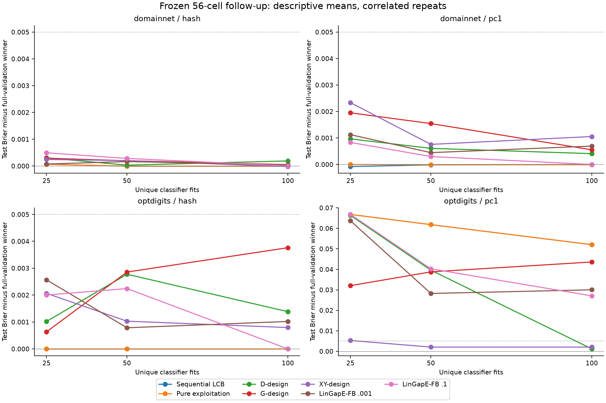
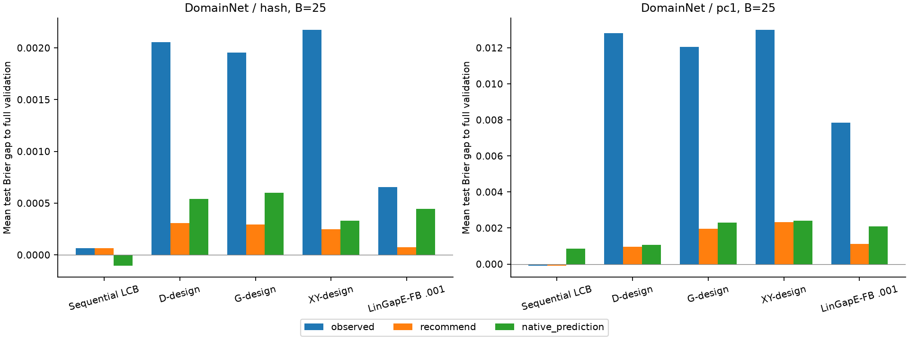

# 线性最佳臂识别与实验设计公平对照：结果与创新性判断

日期：2026-11-17。基于 Rebuttal 分支 `51fce47f26c6f447edc89808bd5fe280e18cba71`，未修改原论文或旧实验代码。

## 结论先说

**作为固定源池组合选择的轻量启发式，现有方法有实证价值；作为一种新的线性最佳臂识别或实验设计算法，当前创新点还站不稳。**

这轮公平对照并未推翻 DomainNet 上的低预算效果：25 次拟合时，本文策略的平均验证 simple regret 和测试 Brier 都优于这批基线。但加入“预测推荐并实际训练”后，实验设计方法与本文的差距明显缩小；许多测试差异在千分之一量级。去掉探索项在 48 组 DomainNet 中有 47 组选择同一模型，因而不能把效果主要归因于新的探索机制。

更重要的是，Optdigits 的 PC1 分池反例仍然存在，而且 XY 实验设计能显著改善这个反例。本文不是在所有候选损失结构下都更好的方法。原版 OD-LinBAI 在合法预算下也能达到接近完整搜索的结果；按实际唯一拟合次数比较，双方没有稳定的普遍胜负关系。

不建议在 rebuttal 中写“提出新的线性 BAI 算法”“首次利用共享池恢复所有候选损失”或“普遍优于最优实验设计”。比较稳妥的贡献定位是：**将固定源池组合选型写成近似线性的低预算搜索问题，给出简单且成本透明的实现，并系统验证它何时有效、何时失效。** 这个定位是否足以满足论文的创新性要求，仍取决于问题本身的重要性、相对已有应用的区别及其余贡献，不能由这批实验单独保证。

## 这次做了什么，怎样保证比较公平

- 沿用上一轮从头生成的 48 组 DomainNet 与 8 组 Optdigits logistic 配置；没有读取另一台服务器的历史特征缓存。所有方法共享 455 个候选、同一分类器、验证集、测试集和候选成本。
- 选型模型统一使用 15 维池组合指示向量，不能让基线丢掉本文使用的结构信息。共同初始化为同一组 15 个满秩查询。
- 共同初始化用于隔离后续分配规则，不代表替每种设计方法找到了全局最优的 25 点设计；D/A/G/XY 均明确为逐步贪心设计。另用自行初始化的原版 OD-LinBAI 作补充，不能把这些对照写成穷尽全部线性 BAI 方法。
- 25 次为主预算，50/100 次为敏感性分析。LinGapE 的四个预设系数 .001/.01/.1/1 全部保留，没有按测试结果选最优参数。
- 区分查询分配和最后的推荐。除“B 次查询后选已测最优”外，还给所有线性方法一个公平版本：先查询 B−1 次，训练预测最优候选，再从 B 个已训练模型中选最优。还单列直接输出预测候选的原生 BAI 终止规则。
- 先冻结全部 56 个配置的选择轨迹，再计算新增测试预测。质量比较使用验证分数回放；真正的时间比较另行从驻留特征重新拟合，未共享已训练模型或预计算设计序列。
- 共 **6,104 条策略决策记录、189 次独立重训计时**；56 个参考模型文件、全部选择锁和输出通过校验。6,104 不是独立数据集数量，也不是重新训练了 6,104 组全模型。
- 这是一轮在已检查过结果的数据上的补充对照，不是新的盲测。种子重复共享数据和测试集，报告描述性差异，不把 48 个单元当成 48 个独立样本做显著性检验。

新增选择器和分类器读出均运行在 CPU。所有服务器执行环境仅暴露物理 GPU0；本轮没有必要重新抽取特征，也没有占用其他 GPU。

完整预先固定的协议见 [Protocol.md](../../linear_bai_20261117/Protocol.md)。

## 新方法与已有工作的对应关系

| 论文中的组成部分 | 与已有方法的关系 | 目前能否单独支撑方法创新 |
|---|---|---|
| 三个池的指示向量与加性损失 | 标准线性特征表示；这里的应用对象是共享训练池组成的分类器候选 | 可以作为问题建模，但不能把线性表示本身当作新算法 |
| 15 个满秩查询恢复 15 个系数 | 无噪声线性方程的可识别性 | 是条件清楚的命题，当前没有超出线性代数的理论贡献 |
| OLS 预测减去 .001 倍杠杆标准差 | 线性下置信界形式；系数是启发式，没有校准成正确置信界 | 不能直接当作新的探索原理 |
| 逐次重拟合与两批执行 | 自适应/批量查询的实现选择 | 可报告成本与效果，但消融不支持它们是主要创新来源 |
| 输出已训练候选中验证最优模型 | 适应真实选型与模型交付需求，降低线性外推失败风险 | 有实践意义；基线获得同样的终止规则后也明显受益 |

[Soare 等（2014）](https://papers.neurips.cc/paper_files/paper/2014/hash/f8d84caae48546d0934d637ab54f7086-Abstract.html) 已把线性 BAI 与 G/XY 实验设计联系起来。
[Xu 等（2018）](https://proceedings.mlr.press/v84/xu18d.html) 的 LinGapE 直接针对候选间的损失差选择测量方向。
[Fiez 等（2019）](https://proceedings.neurips.cc/paper/2019/hash/8ba6c657b03fc7c8dd4dff8e45defcd2-Abstract.html) 则讨论测量集合与推荐集合可不同的 transductive 设定。因此“查询一些组合，推断另一些组合”这一总体思路不是空白。

这里还可以直接看出一个边界：若损失精确等于三个池系数之和，恢复系数之后，从全部三元组合中选择最优，只需选择系数最低的三个池。组合枚举并不使这一步成为新的线性优化问题。真实难点在于损失不精确可加，而这正是当前反例暴露的问题。

## 同预算 25 次：DomainNet 主结果

下表合并 hash/PC1，各 24 个配置。Brier 越低越好；验证 simple regret 是所选模型的验证损失减去 455 个候选中的最小验证损失，才是选型算法直接优化的目标。full 由验证集选出，绝不是按测试分数选出的 oracle。测试 gap 可为负。

| 方法 | 测试 Brier ↓ | 验证 simple regret ↓ | 与 full 同一赢家 | 测试 gap > .005 |
|---|---|---|---|---|
| 逐次 LCB（本文） | 0.916072 | 0.000085 | 39/48 | 0 |
| 两批（本文） | 0.916088 | 0.000088 | 37/48 | 0 |
| 去掉探索项 | 0.916111 | 0.000086 | 38/48 | 0 |
| D-design + 推荐 | 0.916716 | 0.000949 | 26/48 | 0 |
| A-design + 推荐 | 0.916816 | 0.000911 | 28/48 | 0 |
| G-design + 推荐 | 0.917201 | 0.001311 | 22/48 | 2 |
| XY-design + 推荐 | 0.917369 | 0.001600 | 22/48 | 3 |
| LinGapE-FB，c=.001 | 0.916678 | 0.000768 | 32/48 | 3 |
| LinGapE-FB，c=.01 | 0.916636 | 0.000582 | 30/48 | 1 |
| LinGapE-FB，c=.1 | 0.916742 | 0.000693 | 29/48 | 1 |
| LinGapE-FB，c=1 | 0.916744 | 0.001057 | 23/48 | 1 |
| MMD | 0.920236 | 0.004644 | 15/48 | 16 |
| Target A-opt | 0.917241 | 0.001171 | 27/48 | 4 |

本文总体仍占优，但需要注意差异尺度。直接与 MMD 相比会呈现较大的优势；换成共享池结构的 D/A/G/XY 设计或 LinGapE 后，优势明显缩小。所有适配方法的完整参数和终止规则结果均在 `summary.csv`，不能只挑其中最弱的一列来写论文。

## 终止规则会大幅影响结论

如果要求实验设计方法只能从它探索过的 25 个候选中选模型，实际上忽略了它通过线性回归推断未测候选的用途。我们的主对照因此给了它们“24 次探索 + 1 次推荐训练”。例如 DomainNet/PC1 的 D-design，仅选已测模型时平均测试 gap 约为 .0128；加入推荐训练后约为 .0010。这个差别远大于本文与合理基线之间的差距。

三种规则都列出，避免只使用对本文有利的规则：

- `observed`：按策略用完 B 次，选已测验证最优。
- `recommend`：B−1 次后用 OLS 推荐；若推荐已测，就再测下一个预测最优未测候选；最终选全部已测最优。
- `native_prediction`：直接交付 B−1 次后的预测最优候选，不因最后实测差而回退。它始终能在 B 次拟合以内交付。

## 失败边界和预算增长

Optdigits/PC1，B=25：本文 Brier **.406669**，D-design **.406229**，A-design **.376545**，G-design **.371922**，XY-design **.345173**；完整验证为 **.339867**。XY 的验证 simple regret 也从本文的 **.059715** 降到 **.009403**，因此这不只是碰巧测试分数更好。

到 B=100，本文仍为 **.391922**，D-design 已到 **.341057**，XY 为 **.341944**。不能把当前失败解释成“只要再加一点预算就能自动修复”。与此同时，DomainNet/PC1 上 LinGapE-FB(c=.1) 在 B=100 的 24 个配置全部命中完整验证赢家，本文为 23/24。

| 数据/分池 | 方法 | B=25：Brier (同赢家) | B=50 | B=100 |
|---|---|---|---|---|
| domainnet/hash | 逐次 LCB（本文） | 0.922283 (19/24) | 0.922212 (23/24) | 0.922212 (23/24) |
| domainnet/hash | D-design + 推荐 | 0.922524 (13/24) | 0.922249 (16/24) | 0.922407 (18/24) |
| domainnet/hash | XY-design + 推荐 | 0.922463 (13/24) | 0.922419 (15/24) | 0.922197 (18/24) |
| domainnet/hash | LinGapE-FB，c=.1 | 0.922711 (13/24) | 0.922500 (17/24) | 0.922223 (21/24) |
| domainnet/pc1 | 逐次 LCB（本文） | 0.909862 (20/24) | 0.909925 (22/24) | 0.909934 (23/24) |
| domainnet/pc1 | D-design + 推荐 | 0.910907 (13/24) | 0.910550 (14/24) | 0.910349 (18/24) |
| domainnet/pc1 | XY-design + 推荐 | 0.912276 (9/24) | 0.910699 (15/24) | 0.910996 (14/24) |
| domainnet/pc1 | LinGapE-FB，c=.1 | 0.910773 (16/24) | 0.910240 (18/24) | 0.909941 (24/24) |
| optdigits/hash | 逐次 LCB（本文） | 0.299730 (4/4) | 0.299730 (4/4) | 0.299730 (4/4) |
| optdigits/hash | D-design + 推荐 | 0.300751 (3/4) | 0.302507 (1/4) | 0.301114 (2/4) |
| optdigits/hash | XY-design + 推荐 | 0.301795 (2/4) | 0.300761 (2/4) | 0.300525 (3/4) |
| optdigits/hash | LinGapE-FB，c=.1 | 0.301733 (1/4) | 0.301973 (1/4) | 0.299730 (4/4) |
| optdigits/pc1 | 逐次 LCB（本文） | 0.406669 (0/4) | 0.401690 (0/4) | 0.391922 (0/4) |
| optdigits/pc1 | D-design + 推荐 | 0.406229 (0/4) | 0.379462 (0/4) | 0.341057 (3/4) |
| optdigits/pc1 | XY-design + 推荐 | 0.345173 (0/4) | 0.341944 (2/4) | 0.341944 (2/4) |
| optdigits/pc1 | LinGapE-FB，c=.1 | 0.406669 (0/4) | 0.380145 (0/4) | 0.366933 (0/4) |

这些预算点分别执行其终止步骤，`recommend` 的候选集合不一定嵌套；测试误差也不保证随验证查询次数单调下降。不能从曲线的个别上升段推导“多查询一定有害”。

## 原版 OD-LinBAI：保持合法预算，同时核算真实成本

[Yang 与 Tan（2022）](https://proceedings.neurips.cc/paper_files/paper/2022/hash/4f9342b74c3bb63f6e030d8263082ab6-Abstract-Conference.html) 的 Algorithm1/Eq1 在 d=15、K=455、B=25 时没有合法的正阶段预算，不能硬截成 25 次后声称复现了原算法。

这里按原 Eq1 使用 T=200，得到 m=16.5，执行四个阶段，活动集合降为 8/4/2/1；每阶段只用本阶段的数据估计。初始 G-optimal 设计使用 35 个 Steiner 三元组，其信息矩阵与全体三元组均匀设计相同；数值检查确认最大杠杆为维数。之后在实际张成空间中求 G-optimal 设计，容差 1e−6。

实际消耗 **91–97 次 pull、41–43 个不同模型拟合**。因为本任务分数确定，重复 pull 不提供新信息，不能冒充 91–97 份独立观测。因此下面主要比较本文逐次算法在**逐配置完全相同的唯一拟合数**下的结果，而不是拿 200 次对 25 次直接判输赢。原版假设下的随机噪声保证不外推到本任务。

| 数据/分池 | OD 终止规则 | OD 唯一拟合数 | OD Brier | 本文相同唯一拟合数 Brier | OD 同 full |
|---|---|---|---|---|---|
| domainnet/hash | native_prediction | 41–43 | 0.922337 | 0.922212 | 20/24 |
| domainnet/hash | observed | 41–43 | 0.922321 | 0.922212 | 20/24 |
| domainnet/pc1 | native_prediction | 41–43 | 0.909925 | 0.909978 | 22/24 |
| domainnet/pc1 | observed | 41–43 | 0.909925 | 0.909978 | 22/24 |
| optdigits/hash | native_prediction | 42–43 | 0.299369 | 0.299730 | 3/4 |
| optdigits/hash | observed | 42–43 | 0.299369 | 0.299730 | 3/4 |
| optdigits/pc1 | native_prediction | 43–43 | 0.440156 | 0.402315 | 0/4 |
| optdigits/pc1 | observed | 43–43 | 0.371922 | 0.402315 | 0/4 |

DomainNet/PC1 原版 OD 在 22/24 个配置命中 full，hash 为 20/24；总体 42/48。本文在相同唯一拟合数下并没有对两种构造均形成优势。Optdigits/PC1 的 OD 原生预测很差（.440156），但共享“已测最优回退”后为 .371922，优于本文同等唯一拟合成本下的 .402315。必须同时保留这两个结果，不能只报原生失败的一项。

## 实际耗时

全部时间从驻留投影特征开始，包括初始化、设计准则或自适应计算、25 次全新分类器拟合和验证选型。缓存读取与哈希检查单列在 CSV，未混入主时间。没有将回放速度当作模型训练速度。

六个 DomainNet 目标、hash、第一种子、每种方法三次重复，单拟合线程/BLAS1；以下为 18 次运行中位数。最后一列先在同目标、同重复上计算“基线耗时 / 本文耗时”，再取中位数，>1 表示基线更慢。计算开销指除拟合和验证以外的选型开销。

| 方法 | 总时间/秒 | 选型计算开销/秒 | 相对本文时间倍数 |
|---|---|---|---|
| 逐次 LCB（本文） | 3.309 | 0.009 | 1.000 |
| 两批（本文） | 3.330 | 0.002 | 0.993 |
| 去掉探索项 | 3.296 | 0.009 | 0.992 |
| D-design + 推荐 | 3.352 | 0.007 | 1.013 |
| A-design + 推荐 | 3.338 | 0.008 | 1.004 |
| G-design + 推荐 | 3.349 | 0.017 | 1.014 |
| XY-design + 推荐 | 8.434 | 5.126 | 2.553 |
| LinGapE-FB，c=.001 | 3.356 | 0.013 | 1.008 |
| LinGapE-FB，c=.1 | 3.313 | 0.013 | 1.004 |

Optdigits 同样三次独立重复：

| 方法 | 总时间/秒 | 选型计算开销/秒 |
|---|---|---|
| 逐次 LCB（本文） | 0.496 | 0.009 |
| 两批（本文） | 0.481 | 0.002 |
| 去掉探索项 | 0.497 | 0.008 |
| D-design + 推荐 | 0.488 | 0.008 |
| A-design + 推荐 | 0.489 | 0.009 |
| G-design + 推荐 | 0.514 | 0.026 |
| XY-design + 推荐 | 12.198 | 11.700 |
| LinGapE-FB，c=.001 | 0.503 | 0.013 |
| LinGapE-FB，c=.1 | 0.494 | 0.013 |

硬件与上一轮相同：Xeon Gold 6133，共享服务器，自己的其他实验计算已暂停；不能声称整台机器独占。这里测的是本次参考实现，尤其 XY 用精确的一步全候选、全候选对搜索，不能把其实现耗时当作所有 XY 近似求解器的下界。D/A/G 与 LinGapE 的低维计算也很轻，不能只选最慢的 XY 宣传普遍速度优势。本轮未重新测原图流程、四线程或 OD-LinBAI 的独立墙钟时间，不对它们作新的时间结论。

## 对 rebuttal 和后续工作的具体建议

**本轮可以直接写入的证据**：在固定的 15 池、455 候选、25 次拟合设置下，轻量的利用型查询在 DomainNet 上有较好的质量—预算表现；原图准备和并行条件的边界沿用上一轮实测。主表应加入 D-design、G-design、XY-design、LinGapE-FB，以及已存在的纯利用消融；解释为什么基线得到一次推荐训练。

**应主动收回或弱化的说法**：15 次线性恢复不作为独立理论突破；不把固定 .001 探索项写成新的置信界；不声称逐轮更新不可替代；不以本轮适配版结果宣称击败原版 LinGapE/RAGE 的理论或一般性能。它们原本的重复带噪观测与固定置信度任务不同。

**如果要争取更强的方法贡献，下一步应研究尚未解决的机制，而不是再补几张领先表。** 最直接的缺口是低预算下的模型失配：能否在有限的额外探测中识别加性失效，并在利用型查询与覆盖性设计间切换？必须预留独立探测查询、计入总预算，在未用于设计规则的新数据上验证。初始 15 参数/15 观测可以零残差插值，不能用其训练残差作可靠的失配告警。简单增加 105 个二阶参数也不能在 25 次观测下自动获得可识别性。这只是后续方向，本轮没有把尚未验证的修复包装成贡献。

可用的英文回复框架：

> We have added comparisons with incidence-based experimental-design baselines and a finite-budget, no-repeat adaptation of LinGapE, all using the same candidate features, validation data, and fitting budget. To avoid disadvantaging exploration-oriented methods, we also reserve one fit to instantiate their predicted recommendation. Our policy retains a small-budget advantage on the present DomainNet test bed, whereas XY-design is substantially more robust on the non-additive Optdigits construction. We therefore position the method as a lightweight strategy for approximately additive pool-combination selection, rather than a new general linear best-arm identification algorithm. We also evaluate OD-LinBAI at an admissible budget and compare actual distinct model fits.

上段必须与具体表格、适配说明和负结果一起使用。当前证据支持应用价值，尚不足以消除审稿人对核心算法新颖性的质疑。

## 分构造完整主表

胜/平/负以测试 Brier 对本文逐次25为参照，阈值仅为数值平局容差 1e−12；不是显著性检验。超过 +.005 为描述性阈值。

### domainnet / hash

| 方法 | 终止规则 | 测试 Brier ↓ | 验证 simple regret ↓ | 相对逐次 ΔBrier | 同全量赢家 | 超过 +.005 | 胜/平/负 |
|---|---|---|---|---|---|---|---|
| Sequential LCB | observed | 0.922283 | 0.000097 | +0.000000 | 19/24 | 0 | 0/24/0 |
| Two-batch | observed | 0.922263 | 0.000123 | -0.000019 | 17/24 | 0 | 2/20/2 |
| Pure exploitation | observed | 0.922283 | 0.000097 | +0.000000 | 19/24 | 0 | 0/24/0 |
| D-design | recommend | 0.922524 | 0.000402 | +0.000242 | 13/24 | 0 | 3/12/9 |
| A-design | recommend | 0.922502 | 0.000352 | +0.000219 | 16/24 | 0 | 4/14/6 |
| G-design | recommend | 0.922509 | 0.000380 | +0.000226 | 13/24 | 0 | 1/15/8 |
| XY-design | recommend | 0.922463 | 0.000418 | +0.000180 | 13/24 | 0 | 1/15/8 |
| LinGapE-FB .001 | recommend | 0.922291 | 0.000246 | +0.000008 | 17/24 | 0 | 1/20/3 |
| LinGapE-FB .01 | recommend | 0.922551 | 0.000401 | +0.000268 | 14/24 | 0 | 3/14/7 |
| LinGapE-FB .1 | recommend | 0.922711 | 0.000506 | +0.000428 | 13/24 | 0 | 2/15/7 |
| LinGapE-FB 1 | recommend | 0.922634 | 0.000596 | +0.000351 | 10/24 | 0 | 2/12/10 |
| MMD | observed | 0.926531 | 0.004241 | +0.004249 | 7/24 | 6 | 2/7/15 |
| Target A-opt | observed | 0.922727 | 0.000584 | +0.000445 | 13/24 | 0 | 2/13/9 |

### domainnet / pc1

| 方法 | 终止规则 | 测试 Brier ↓ | 验证 simple regret ↓ | 相对逐次 ΔBrier | 同全量赢家 | 超过 +.005 | 胜/平/负 |
|---|---|---|---|---|---|---|---|
| Sequential LCB | observed | 0.909862 | 0.000073 | +0.000000 | 20/24 | 0 | 0/24/0 |
| Two-batch | observed | 0.909912 | 0.000053 | +0.000050 | 20/24 | 0 | 1/21/2 |
| Pure exploitation | observed | 0.909940 | 0.000074 | +0.000078 | 19/24 | 0 | 0/23/1 |
| D-design | recommend | 0.910907 | 0.001495 | +0.001045 | 13/24 | 0 | 1/14/9 |
| A-design | recommend | 0.911131 | 0.001471 | +0.001269 | 12/24 | 0 | 0/13/11 |
| G-design | recommend | 0.911892 | 0.002243 | +0.002030 | 9/24 | 2 | 0/10/14 |
| XY-design | recommend | 0.912276 | 0.002782 | +0.002414 | 9/24 | 3 | 2/8/14 |
| LinGapE-FB .001 | recommend | 0.911066 | 0.001289 | +0.001204 | 15/24 | 3 | 1/18/5 |
| LinGapE-FB .01 | recommend | 0.910722 | 0.000763 | +0.000860 | 16/24 | 1 | 0/17/7 |
| LinGapE-FB .1 | recommend | 0.910773 | 0.000879 | +0.000911 | 16/24 | 1 | 0/19/5 |
| LinGapE-FB 1 | recommend | 0.910854 | 0.001518 | +0.000992 | 13/24 | 1 | 1/15/8 |
| MMD | observed | 0.913940 | 0.005047 | +0.004078 | 8/24 | 10 | 1/8/15 |
| Target A-opt | observed | 0.911755 | 0.001757 | +0.001893 | 14/24 | 4 | 0/14/10 |

### optdigits / hash

| 方法 | 终止规则 | 测试 Brier ↓ | 验证 simple regret ↓ | 相对逐次 ΔBrier | 同全量赢家 | 超过 +.005 | 胜/平/负 |
|---|---|---|---|---|---|---|---|
| Sequential LCB | observed | 0.299730 | 0.000000 | +0.000000 | 4/4 | 0 | 0/4/0 |
| Two-batch | observed | 0.300364 | 0.000155 | +0.000634 | 3/4 | 0 | 0/3/1 |
| Pure exploitation | observed | 0.299730 | 0.000000 | +0.000000 | 4/4 | 0 | 0/4/0 |
| D-design | recommend | 0.300751 | 0.000207 | +0.001021 | 3/4 | 0 | 0/3/1 |
| A-design | recommend | 0.302644 | 0.001296 | +0.002914 | 1/4 | 0 | 0/1/3 |
| G-design | recommend | 0.300364 | 0.000155 | +0.000634 | 3/4 | 0 | 0/3/1 |
| XY-design | recommend | 0.301795 | 0.000788 | +0.002065 | 2/4 | 0 | 0/2/2 |
| LinGapE-FB .001 | recommend | 0.302299 | 0.001974 | +0.002569 | 1/4 | 1 | 0/1/3 |
| LinGapE-FB .01 | recommend | 0.301396 | 0.001394 | +0.001666 | 1/4 | 0 | 1/1/2 |
| LinGapE-FB .1 | recommend | 0.301733 | 0.001133 | +0.002003 | 1/4 | 0 | 0/1/3 |
| LinGapE-FB 1 | recommend | 0.301726 | 0.000586 | +0.001996 | 2/4 | 0 | 0/2/2 |
| MMD | observed | 0.302909 | 0.005058 | +0.003179 | 0/4 | 0 | 0/0/4 |
| Target A-opt | observed | 0.304332 | 0.003489 | +0.004602 | 0/4 | 1 | 0/0/4 |

### optdigits / pc1

| 方法 | 终止规则 | 测试 Brier ↓ | 验证 simple regret ↓ | 相对逐次 ΔBrier | 同全量赢家 | 超过 +.005 | 胜/平/负 |
|---|---|---|---|---|---|---|---|
| Sequential LCB | observed | 0.406669 | 0.059715 | +0.000000 | 0/4 | 4 | 0/4/0 |
| Two-batch | observed | 0.406669 | 0.059715 | +0.000000 | 0/4 | 4 | 0/4/0 |
| Pure exploitation | observed | 0.406669 | 0.059715 | +0.000000 | 0/4 | 4 | 0/4/0 |
| D-design | recommend | 0.406229 | 0.047785 | -0.000440 | 0/4 | 4 | 1/1/2 |
| A-design | recommend | 0.376545 | 0.032094 | -0.030124 | 0/4 | 4 | 4/0/0 |
| G-design | recommend | 0.371922 | 0.035718 | -0.034747 | 0/4 | 4 | 4/0/0 |
| XY-design | recommend | 0.345173 | 0.009403 | -0.061496 | 0/4 | 2 | 4/0/0 |
| LinGapE-FB .001 | recommend | 0.403567 | 0.054286 | -0.003102 | 0/4 | 4 | 1/3/0 |
| LinGapE-FB .01 | recommend | 0.403567 | 0.054286 | -0.003102 | 0/4 | 4 | 1/3/0 |
| LinGapE-FB .1 | recommend | 0.406669 | 0.059715 | +0.000000 | 0/4 | 4 | 0/4/0 |
| LinGapE-FB 1 | recommend | 0.380168 | 0.036024 | -0.026501 | 0/4 | 4 | 4/0/0 |
| MMD | observed | 0.339867 | 0.000000 | -0.066802 | 4/4 | 0 | 4/0/0 |
| Target A-opt | observed | 0.339867 | 0.000000 | -0.066802 | 4/4 | 0 | 4/0/0 |

## 复现与交付

- [原始逐配置结果](all_outcomes.csv)：6,104 条决策，包含 Brier、accuracy、NLL、验证 regret、实际拟合数与 pull 数。
- [完整参数与终止规则汇总](summary.csv)、[按目标域的配对差异](domain_paired_differences.csv)、[原版 OD 对照](od_comparison.csv)。
- [独立计时](all_timings.csv)、[验证结果](verification.json)、[实现自检](implementation_checks.json)。
- 每个配置保留 `decisions.json`、`freeze.json`、`selection_lock.json`、`audit.json`；`all_selection_locks.json` 在首次新增测试审计前生成。
- `source_freeze.json` 记录实验源文件和旧读出代码；后续报告脚本另纳入交付快照，不覆盖冻结实验代码。
- 服务端结果目录：`/home/ubuntu/caozheng/collapsemodel_rebuttal_20261117/linear_runs`；完整参考分类器权重继续保留在同项目的 `runs`，本地交付包含可校验元数据与新增结果。
- [代码与协议快照](source_snapshot.zip) 包含本轮代码和依赖的上一轮源代码，不含账号密码或训练数据。

文献核对使用 citation-management 技能；工具来源记录为 Kassis 等（2026），[Scientific Agent Skills](https://doi.org/10.48550/arXiv.2609.00065)。它只是工具致谢，不作为算法有效性的证据。
